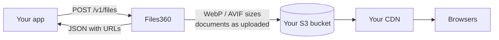

<div align="center">

# Files360

**Self-hosted image and file API. Upload once, get optimized CDN URLs, keep everything on your own bucket.**

Built and maintained by [Dot360](https://dot360.io)

[](https://github.com/dot360io/Files360/actions/workflows/ci.yml) [](https://github.com/dot360io/Files360/releases) [](LICENSE) [](https://github.com/dot360io/Files360/pkgs/container/files360) [](package.json) [](https://files360.dev) [](https://www.npmjs.com/package/files360-mcp)

[Docs](https://files360.dev) · [Install](https://files360.dev/install) · [API](https://files360.dev/api) · [Compare](https://files360.dev/comparison) · [Roadmap](PLAN.md)

<!-- TODO: docs/public/demo.gif, the upload dialog in action -->

</div>

---

## In one minute

**The problem.** Every app needs to accept images and documents, resize them, store them somewhere fast and hand back URLs. Hosted services do it well, but they bill per GB and per transformation, keep your files in their account and put their domain in every URL.

**Files360** is that pipeline as one container you run yourself:



1. **Your backend uploads** an image, PDF, Office file, CSV or ZIP to one endpoint.
2. **Files360 processes it.** Images become every size you configured. Documents are stored untouched, with a preview.
3. **Files land in your bucket** (Hetzner, R2, B2, AWS, MinIO, and others). You get the URLs back as JSON.
4. **Browsers load files straight from your bucket or CDN.** Files360 is never in the read path.

---

## Try it in 30 seconds

```bash
curl -O https://raw.githubusercontent.com/dot360io/Files360/main/docker-compose.yml
docker compose up -d
docker compose logs files360 | grep setup     # open the link it prints
```

A setup wizard asks for four things: **database** (SQLite by default, nothing to install), **admin account**, **storage bucket** and **first app**. Then upload:

```bash
curl -X POST https://files.example.com/v1/files \
  -H "Authorization: Bearer $FILES360_API_KEY" \
  -F "file=@photo.jpg" -F "folder=products"
```

```json
{
  "id": "66f1c2a9e4b0a1d2c3f4e5a6",
  "kind": "image",
  "variants": {
    "thumb":  { "url": "https://cdn.example.com/my-shop/products/3f9a…/thumb.webp",  "width": 320,  "height": 320 },
    "medium": { "url": "https://cdn.example.com/my-shop/products/3f9a…/medium.webp", "width": 800,  "height": 600 },
    "large":  { "url": "https://cdn.example.com/my-shop/products/3f9a…/large.webp",  "width": 1600, "height": 1200 }
  },
  "srcset": "…/medium.webp 800w, …/large.webp 1600w"
}
```

Upload the same file again and you get the same record back with `"duplicate": true`, so retries are always safe.

---

## Who it is for

| You are… | Files360 gives you… |
| --- | --- |
| **A team paying a media SaaS every month** | the same upload, resize and serve flow for the price of a small server and a bucket |
| **An agency running many client sites** | one instance, one app per client, each with its own folder, sizes, keys and bucket |
| **Bound by data residency rules** | files that stay in the region and the account you chose |
| **Building with AI agents** | an MCP server, `/openapi.json` and `/llms.txt`, so agents can upload directly |
| **Self-hosting everything already** | one container, SQLite, no telemetry, arm64 images |

---

## How it compares

Hosted media services are excellent at some things. Here is the honest version:

| | **Files360** | Cloudinary | imgix | Uploadcare |
| --- | :---: | :---: | :---: | :---: |
| Monthly cost | your server + bucket | from $99 | from $25 | from $79 |
| Files live in | **your bucket** | their storage | your bucket | their storage |
| Plain URLs, no vendor syntax | **yes** | no | no | no |
| Documents with previews | **yes** | PDFs | no | conversion |
| On-the-fly transforms | roadmap | **yes** | **yes** | **yes** |
| Video, AI tagging | no | **yes** | partly | **yes** |
| CDN and ops included | no, you run it | **yes** | **yes** | **yes** |

**Example workload:** 50 GB stored, 500 GB delivered and 20k uploads a month comes to **about €13/month** on a small Hetzner server (CX23) and bucket, against **$249/month** on Cloudinary Advanced. Prices were checked on 2026-10-16, and the [full comparison](https://files360.dev/comparison) shows the sources and the arithmetic.

<sub>Cloudinary, imgix and Uploadcare are trademarks of their owners. Files360 is not affiliated with or endorsed by them; they are named only to compare publicly listed features and prices.</sub>

---

## What you get

| | |
| --- | --- |
| 📤 **One upload endpoint** | Images, PDF, Word, Excel, PowerPoint (incl. 97-2003), CSV, text, ZIP. Types are decided from the bytes, not the file name. |
| 🖼️ **Named sizes per app** | Up to 8 sizes in WebP, AVIF or JPEG, with crop, fit or pad. A ready `srcset`. Images are never upscaled and metadata is stripped. |
| 🪣 **Any S3-compatible bucket** | Presets for 8 providers plus anything with an S3 API. Each connection is checked with a real write, read and delete. |
| 🔗 **URLs that never change** | Keys contain a hash of the file and its settings, so you can cache for a year and never purge. |
| 🗂️ **Media library** | Folders, search, bulk delete, and previews of sheets, documents, decks and archives. |
| 🔑 **Apps and API keys** | Per-app settings, keys shown once and stored hashed, rate limits, and a generated integration guide. |
| 🛡️ **Built for hostile input** | SVG allowlist, pixel limits, capped hand-written parsers, SSRF-safe URL imports. [Details](https://files360.dev/security) |
| 🧙 **Setup wizard** | Pick the database, create the admin, connect storage, all in the browser. Locked behind a one-time token. |
| 🤖 **Agent-ready** | `npx files360-mcp` for Claude, Cursor and others. `/openapi.json` and `/llms.txt` on every instance. |
| 🚚 **Easy migration** | `npm run import-cloudinary` copies an existing Cloudinary library into your folders. [Guide](https://files360.dev/migrating-from-cloudinary) |

---

## What it is not

Saying this up front keeps expectations honest. These are decisions, not missing features:

- ❌ **Not a video transcoder**
- ❌ **No AI tagging, moderation or auto alt text**
- ❌ **Not an object store**: it writes to *your* bucket, it is not an S3 server
- ❌ **Not a hosted service**: there is no Files360 cloud, and the AGPL keeps it that way
- ❌ **Not an image editor**

**On the roadmap:** signed on-the-fly transform URLs (`/t/w_800,q_80/<id>.webp`), upload webhooks, multiple admin accounts, and a Docker Hub image. See [PLAN.md](PLAN.md).

---

## Storage providers

<!-- providers:start -->
| Provider | | Regions | Per-object ACLs |
| --- | --- | --- | --- |
| [Hetzner Object Storage](https://www.hetzner.com) | European buckets, low egress cost. | fsn1, nbg1, hel1 | Yes |
| [DigitalOcean Spaces](https://www.digitalocean.com) | Spaces with the built-in CDN edge. | 9 regions | Yes |
| [Amazon S3](https://aws.amazon.com) | The original. Pair it with CloudFront if you want. | 17 regions | Yes |
| [Cloudflare R2](https://www.cloudflare.com) | No egress fees. Needs a public r2.dev or custom domain. | auto | Bucket-wide only |
| [Backblaze B2](https://www.backblaze.com) | Cheapest per TB, free egress through Cloudflare. | 6 regions | Bucket-wide only |
| [Wasabi Hot Cloud Storage](https://wasabi.com) | Flat pricing, no egress charges. | 12 regions | Yes |
| [Scaleway Object Storage](https://www.scaleway.com) | French provider, S3 compatible. | fr-par, nl-ams, pl-waw | Yes |
| [MinIO Self-hosted](https://min.io) | Your own S3 server. Path-style URLs. | your own endpoint | Yes |
| Other S3-compatible | Any provider with an S3 API: Garage, SeaweedFS, Storj, iDrive e2, OVH, Linode, GCS. | your own endpoint | Yes |
<!-- providers:end -->

---

## FAQ

<details>
<summary><b>Is it really free?</b></summary>

Yes. The software is AGPL-3.0 with no paid tier and no limits. You pay your server and bucket provider directly.
</details>

<details>
<summary><b>Can I use a bucket I already have?</b></summary>

Yes. Connect it under **Storage** in the dashboard. Files360 writes under one folder per app and never touches anything else in the bucket.
</details>

<details>
<summary><b>Do I need Postgres or MySQL?</b></summary>

No. SQLite is the default and is enough for most installs. Postgres and MySQL are there if you want them, with ready compose files.
</details>

<details>
<summary><b>What happens to old URLs when I change an app's sizes?</b></summary>

Nothing. New settings only apply to new uploads. Existing files and URLs never change.
</details>

<details>
<summary><b>Can I put my own CDN in front?</b></summary>

Yes, and you should for global traffic. Set the bucket's public URL to your CDN domain and every returned URL uses it.
</details>

<details>
<summary><b>What does AGPL mean for me?</b></summary>

You can run it, including commercially, for your own apps. If you modify Files360 and offer it to others over a network, you have to share those modifications under the same licence.
</details>

---

## Documentation

| | |
| --- | --- |
| [Install](https://files360.dev/install) | Docker, Postgres or MySQL, from source, reverse proxy |
| [Configure](https://files360.dev/configure) | Environment variables, apps, sizes, backups |
| [Storage providers](https://files360.dev/storage) | Public buckets, ACLs, moving apps between buckets |
| [API reference](https://files360.dev/api) | Every endpoint, with examples in curl, Node.js and PHP |
| [Security](https://files360.dev/security) | What reaches storage, keys, the setup wizard |
| [AI agents](https://files360.dev/agents) | MCP server, OpenAPI, llms.txt |
| [Migrating from Cloudinary](https://files360.dev/migrating-from-cloudinary) | Concept map and the import script |

---

## Contributing

```bash
git clone https://github.com/dot360io/Files360.git && cd Files360
npm install
npm run dev     # http://127.0.0.1:4360, prints a setup link on first run
npm test        # no database server or network needed
```

Read [CONTRIBUTING.md](CONTRIBUTING.md) and [ARCHITECTURE.md](ARCHITECTURE.md) first. Bug reports and feature requests go to [issues](https://github.com/dot360io/Files360/issues). **Security reports** go through [private vulnerability reporting](https://github.com/dot360io/Files360/security/advisories/new), never a public issue.

## Licence

[AGPL-3.0](LICENSE) © [Dot360](https://dot360.io)

Files360 is built and maintained by [Dot360](https://dot360.io), a custom software studio. It started as the upload service behind our own products. Need help running it or building on it? [Get in touch](https://dot360.io).

<div align="center">

**If Files360 saves you a monthly bill, a ⭐ helps other people find it.**

</div>
